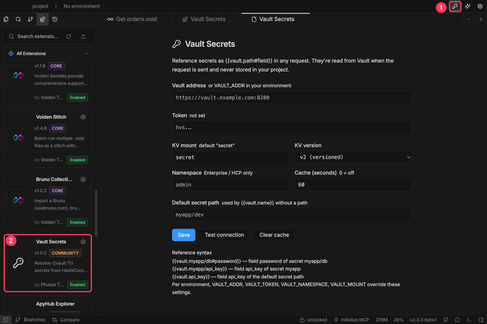
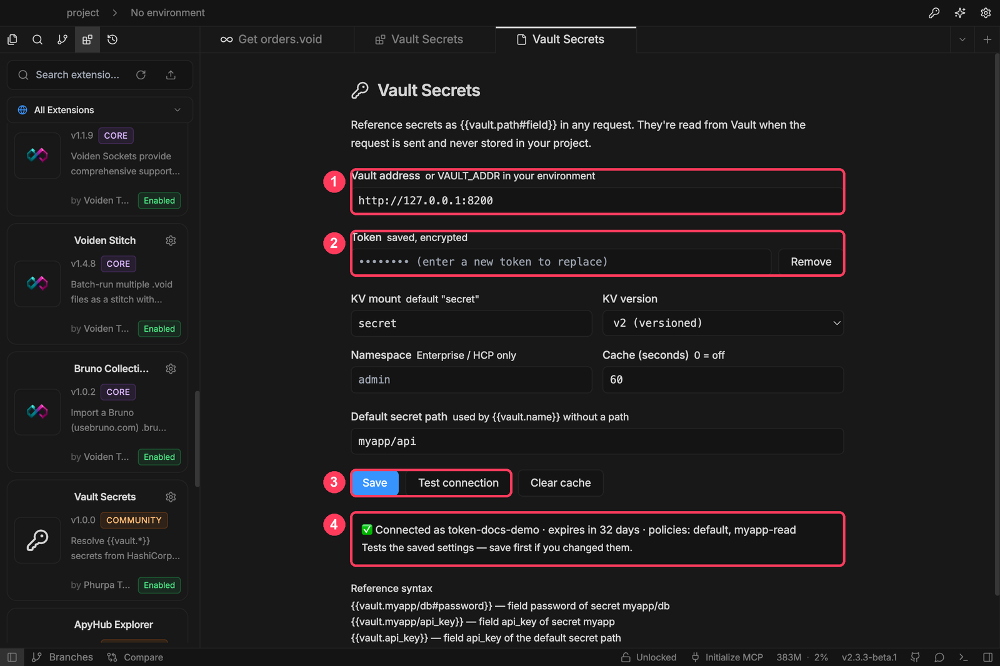
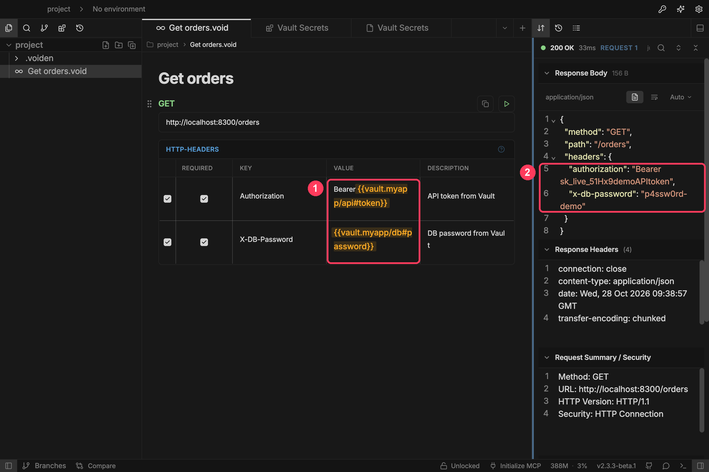
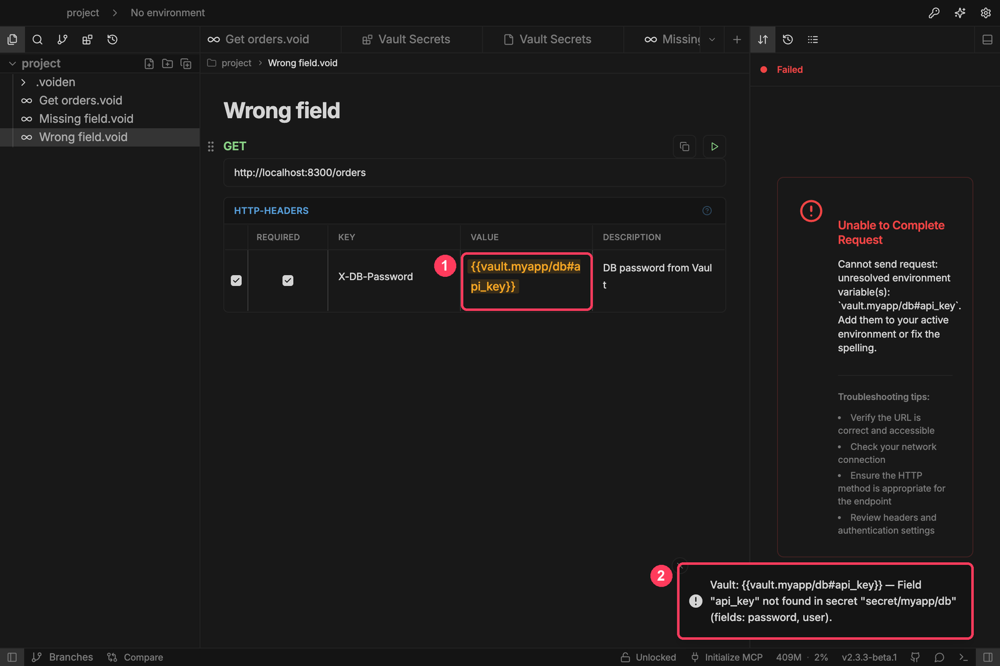

# Vault Secrets for Voiden

Use secrets from [HashiCorp Vault](https://www.vaultproject.io/) in your Voiden requests without storing them in your project.

```
Authorization: Bearer {{vault.myapp/api#token}}
```

Voiden reads the secret from Vault when you send the request. The value never reaches your `.void` files, the editor, or Git.

> **Requires a Voiden version with the plugin variable provider API** (`env.registerVariableProvider`). On older versions the plugin still loads, but `{{vault.*}}` references stay unresolved and the settings page shows a warning.

## What you need

| | |
|---|---|
| **Vault address** | e.g. `https://vault.example.com:8200` |
| **A Vault token** | It needs `read` on the secrets you reference (see the policy below). |
| **A KV secrets engine** | KV v2 (the default) or v1, mounted at `secret` or at a path you choose. |
| **Namespace** | Vault Enterprise / HCP only. |

A minimal policy for a token that reads everything under `secret/myapp/` on a KV v2 mount:

```hcl
path "secret/data/myapp/*" {
  capabilities = ["read"]
}
```

For KV v1, drop `data/`: `path "secret/myapp/*"`.

## Setup

### 1. Install and open the settings

Install the plugin from **Extensions** (or **Extensions → ⋯ → Install from file → `voiden-vault-secrets.zip`**). Then click the **key icon** in the top bar ①. The plugin shows up in your extensions list as **Vault Secrets** ②.



### 2. Connect to Vault

1. Enter your **Vault address** ①.
2. Paste your **token** ②. Once saved, it shows as *saved, encrypted*, and the page never displays it again.
3. Click **Save**, then **Test connection** ③.
4. A green tick ④ confirms the token works and shows who it belongs to, when it expires, and its policies.



All settings:

| Setting | Default | |
|---|---|---|
| Vault address | — | Must start with `http://` or `https://`. |
| Token | — | Needs `read` on the secrets you reference. |
| KV mount | `secret` | Where your KV engine is mounted. |
| KV version | v2 | v1 is supported too. |
| Namespace | — | Vault Enterprise / HCP only. |
| Default secret path | — | Used by bare references like `{{vault.api_key}}`. |
| Cache (seconds) | 60 | How long a secret is reused before it's read again. `0` turns caching off. |

**Clear cache** forgets every cached secret, so the next request reads them fresh, for example right after you rotate a secret.

### 3. Use secrets in requests

Type a `{{vault.…}}` reference anywhere you'd use a variable: URL, headers, query, body. Vault references are highlighted in orange ①, so you can tell them apart from environment variables.

When you send the request, Voiden fills in the real values. Here the echo API sends back what it received ②.



## Reference syntax

| Reference | Reads |
|---|---|
| `{{vault.myapp/db#password}}` | field `password` of secret `myapp/db` |
| `{{vault.myapp/api_key}}` | field `api_key` of secret `myapp` |
| `{{vault.api_key}}` | field `api_key` of the **default secret path** |

`#` always marks the field. Without it, the last path segment is the field. A field that isn't plain text (a number, a list, an object) is sent as JSON.

## When a secret can't be read

If Voiden can't read a secret, it **doesn't send the request**: nothing ever goes out with a placeholder in it. The response panel reports an unresolved variable ①, and a toast explains exactly what went wrong ②.



| Message | What to do |
|---|---|
| `Field "x" not found in secret "secret/myapp/db" (fields: …)` | Fix the field name. The toast lists the fields that do exist. |
| `secret "secret/myapp/db" not found` | Check the path and the KV mount. |
| `Permission denied reading …` | The token is invalid or expired, or its policy doesn't allow `read` on that path. |
| `Can't reach Vault at …` | Check the address, VPN and network. Requests time out after 10 s. |
| `Vault is sealed or unavailable` | Unseal Vault or wait for it to come back. |
| `Secret … has no data (deleted, or is the mount KV v1?)` | The secret was deleted, or switch **KV version** to v1. |
| `No Vault address configured` / `No Vault token configured` | Fill them in on the settings page, or set `VAULT_ADDR` / `VAULT_TOKEN` in your environment. |

## A different Vault per environment

These variables in the **active Voiden environment** override the saved settings:

| Variable | Overrides |
|---|---|
| `VAULT_ADDR` | Vault address |
| `VAULT_TOKEN` | token |
| `VAULT_NAMESPACE` | namespace |
| `VAULT_MOUNT` | KV mount |

For example, `staging` can point at a different Vault than `dev`. Keep `VAULT_TOKEN` in a **private** environment, never a public one, because public environments are committed to Git.

**Test connection** always checks the saved settings, not the environment overrides.

## How it works

- **Secrets are read in Voiden's main process.** The `vault` variable provider runs there, so secret values never pass through the editor or the renderer.
- **The token is encrypted with your OS keychain** (macOS Keychain, Windows DPAPI, libsecret on Linux) and saved in Voiden's user data folder (`plugin-data/voiden-vault-secrets/config.json`, readable only by you). If OS encryption isn't available, the token is kept in memory until Voiden quits and is never written to disk in plain text.
- **Secrets are cached in memory**, 60 s by default, so a request with several references to one secret, or a run of requests, reads it from Vault once. The cache is keyed by address, namespace, token, mount and path, so switching tokens never serves another token's secrets. Failed reads are never cached.
- **Calls Vault makes:** `GET /v1/<mount>/data/<path>` (KV v2) or `GET /v1/<mount>/<path>` (KV v1) to read secrets, and `GET /v1/auth/token/lookup-self` for **Test connection**.

## Development

```bash
npm install
npm test          # unit tests
npm run build     # dist/voiden-vault-secrets.js + dist/voiden-vault-secrets-main.cjs
npm run zip       # dist/voiden-vault-secrets.zip
```

To develop it live, open this folder as a project in Voiden, turn on **Plugin Dev Mode** (puzzle icon), and press **Run**.

| File | |
|---|---|
| `src/main-process.ts` | Registers the `vault` provider and the settings IPC handlers. |
| `src/resolver.ts` | Reference → secret value, with caching and environment overrides. |
| `src/reference.ts` | Parses `path#field` references. |
| `src/vaultClient.ts` | Vault HTTP calls (KV v1/v2, token lookup) and error messages. |
| `src/configStore.ts` | Settings and encrypted token storage. |
| `src/plugin.ts`, `src/SettingsPage.tsx` | Top-bar button, settings tab, `{{vault.*}}` highlighting, error toasts. |

The screenshots in `docs/screenshots/` use a local test Vault with demo values.

## Roadmap

- Doppler and Infisical providers
- A secret path browser
- Other auth methods (AppRole, OIDC)

## License

Apache-2.0
